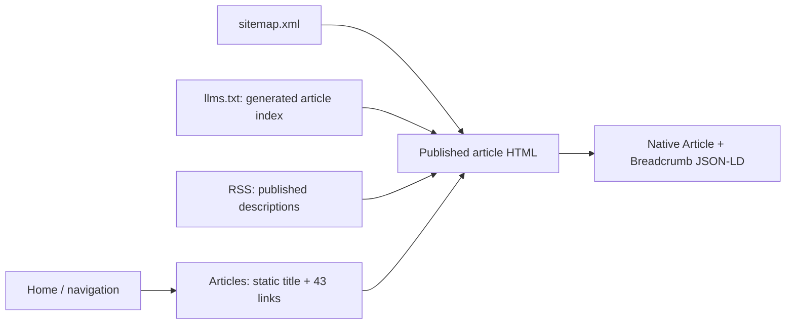

# SEO / AI retrieval audit · lizliz.xyz · 2026-11-02

Source audit began 2026-11-01 (Asia/Shanghai); live baseline retrieved 2026-11-01 15:59–16:03 UTC. Scope: public content discovery, not article rewrites, keyword strategy, or measured AI citation share.

## Findings and safe refinements

| Priority | Observed in deployed HTML / source | Refinement |
|---|---|---|
| P1 | `/articles/` returns 200 but contains no `main`, headings, or article-directory links without JS. `useSearchParams` suspends the entire list. | Isolate URL reading behind a small `Suspense` boundary; prerender the directory and preserve interactive category filtering. |
| P1 | Article / breadcrumb schema lives in executable `self.__next_s` queues, not native JSON-LD elements. Directory, skills, template and home schemas also require hydration. Root Person / WebSite schema is already native. | Use one native `JsonLd` component for public-page schema, following Next.js guidance; escape `<` when serializing. Keep analytics on `next/script`. |
| P2 | Article `wordCount` is a display string such as `4k 字`; Chinese body content inherits English document language. Article schema omits the existing fallback image. | Emit integer counts, `inLanguage`, Chinese article language and OG locale, semantic publication time and an absolute image URL. Preserve displayed word counts. |
| P2 | 48 of 49 sitemap locations omit the trailing slash used by canonical routes. Static `lastmod` changes on every build, whether content changed or not. | Emit slash-terminated route URLs; retain source publication/update dates for articles and podcasts; omit unsupported static-page timestamps. Align schema URLs. |
| P2 | `llms.txt` has only four selected article links; a hand-maintained index can miss new writing. | Keep curated links and identity; generate a complete published title/description index during the existing RSS prebuild step. Do not expose private or draft content or duplicate full article bodies. |
| P2 | Home schema includes skills/templates that the visible homepage intentionally filters out. | Use `getSiteProjects()` for both visible home data and schema. No navigation or visual redesign. |
| P2 | RSS uses the newest-published article's update date rather than the newest update across articles. | Select the maximum known update date. The current 43-item feed content does not change. |

`llms.txt` is a supplemental discovery aid, not a promise that search or AI engines consume it. The strongest repairs are the readable directory and native structured data.

## Existing baseline worth preserving

- Next.js 16.2.4 static export, Cloudflare Pages Git deployment, `trailingSlash: true`; no framework/dependency changes.
- Home, article, skills, templates and podcast samples: 200; apex canonical; title, description and OG/Twitter image baseline present. Unknown paths return actual 404, not a soft-404 SPA shell.
- All 43 Markdown articles have titles, descriptions and publication dates; 43 RSS items and 49 sitemap locations (5 static + 43 articles + 1 podcast).
- Sample article bodies are available without JS, with one H1 and structured sections; related/adjacent links already exist. `/articles/` was the directory-specific exception.
- `/robots.txt`, `/sitemap.xml`, `/rss.xml`, `/llms.txt`, `/agents.md` are reachable. Public `agents.md` is now a short site brief, not the old leaked coding rulebook.
- GA4 `G-TXVLTJJ878` remains unchanged. The 2026-08-08 audit records a verified GSC domain property; absence of a meta token is **not** evidence of missing ownership. Account access was not reverified here.
- Unlisted `/share/*` and workbook pages are deliberately noindex; keep them out of discovery files.

## Requires Liz / separate scope

1. **Cloudflare crawler policy:** deployed managed robots blocks GPTBot, ClaudeBot, Google-Extended and others. OAI-SearchBot, PerplexityBot, Claude-SearchBot and Googlebot inherit `Allow: /`; training controls are not the same as AI search retrieval controls. `Content-Signal: search=yes,ai-train=no,use=reference` is present. Do not override policy in repo robots or promise that changing training access improves citations. Review actual edge/WAF bot responses and intended policy before changing account settings.
2. **Host duplication:** `www.lizliz.xyz` and `lizliz-xyz.pages.dev` still return 200 rather than redirecting to apex. Sample www HTML declares the apex canonical. A www→apex Cloudflare redirect is an operator decision; no dashboard/production config changed here.
3. **Content maintenance:** 18/43 source articles contain no explicit HTTP(S) source link. This is not automatically a defect in fiction or personal reflection; factual technical articles such as `agent-payment-infra`, `agent-operated-saas` and `grok-bot` merit source/date review. Check current product names, availability and claims before extending their search reach. Do not fabricate citations or force FAQs onto essays.
4. **Content shape:** `dont-die` is a short note without Markdown section headings. Do not inflate it for SEO. Major summaries, topic hubs, new titles and per-article art require editorial intent and search evidence, not a bulk rewrite.
5. **Actual performance:** no new ranking, traffic, indexing or AI-answer visibility metrics were bought or inferred. Connected OpenSEO lists only Brain Rush, not lizliz.xyz. Read existing GSC performance and choose a small topic/prompt baseline before buying new research or opening a tracker. No new OpenSEO project/report/schedule created.
6. **Production operations:** public reachability/TLS and a prior successful Git-connected deployment were verified; independent uptime monitoring, delivered alerts, recovery drills and cost controls were not verified. A static export does not require a server error SDK just to tick a box. Liz owns review of monitoring/alerts before claiming full production readiness.

## Verification and rollout boundary

- `pnpm exec tsc --noEmit --incremental false`: passed.
- Targeted ESLint: no errors; two existing article-renderer warnings (`_node`, obsolete disable directive); the CJS script is excluded by the existing ESLint config and was checked with `node --check` instead.
- Isolated generator fixture: draft omission, complete index, title/XML escaping, latest update date, deterministic regeneration, and deleted article removal passed.
- JSON-LD fixture: native script element and safe round-trip of `</script>` text passed.
- `git diff --check`: passed.
- Local full build intentionally not run; use the authorized commit/push → existing GitHub CI / Cloudflare build, then verify exported HTML and category interactions on the deployed target. **This source audit does not itself assert that the new build is deployed.** Deployment IDs, final commit and post-deploy checks belong in the fleet receipt.
- Evidence archive on this host: `~/dev/_archived/lizliz-seo-2026-11-02/` (baseline HTML, inventories and isolated fixture checks). No article text edited.

### Primary implementation references

- [Next.js JSON-LD guide](https://nextjs.org/docs/app/guides/json-ld): native script tags for data, not `next/script` execution.
- [Next.js useSearchParams](https://nextjs.org/docs/app/api-reference/functions/use-search-params): prerendering stops at the nearest Suspense boundary.
- [Next.js CSR bailout guidance](https://nextjs.org/docs/messages/missing-suspense-with-csr-bailout): isolate the smallest URL-dependent subtree.

Confidence: high for observed source/HTML failures and bounded fixes; unknown for traffic/citation impact. Owner: SEO worker for code/deployment verification; Liz for editorial priorities, host policy and first-party measurement. Next checkpoint: verify the target Git deployment, then inspect GSC indexing and useful impressions after recrawl.
